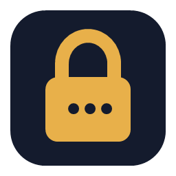
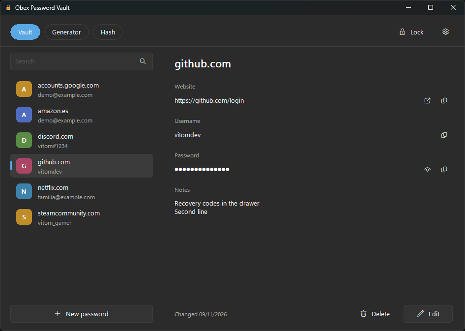
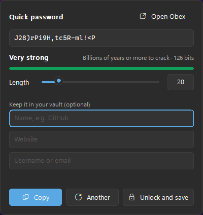

<p align="center"></p>

# 🔐 Obex — Password Vault
[](https://opensource.org/licenses/MIT)

Your passwords in one encrypted file, on your PC. 🗝️  
Unlock it with Windows Hello, find any password in a second and copy it with one click. Press `Ctrl + Alt + O` anywhere for a new strong password, and keep it in your vault in the same step.

Obex (Latin for *bolt* or *barrier*) lives in the notification area and works **100% offline**: no accounts, no cloud, no telemetry.

<p align="center">&nbsp;&nbsp;</p>

---

## 🚀 Features

- ⚡ **Quick password** (`Ctrl + Alt + O`): a small panel pops up in the corner with a new password, its strength and length. Copy it, or type a name, website and username to save it in your vault (if Obex is locked, it asks Windows Hello and saves it right after)
- 🗄️ **Vault**: name, website, username, password and notes for each entry
  - 🔍 **Search** as you type, across names, websites, usernames and notes
  - 📋 **Copy** the username or password with one click; the clipboard is **cleared after 30 seconds**
  - 🙈 Copied passwords stay out of the Windows clipboard history (`Win + V`) and the cloud clipboard
  - 🌐 Open the website in your browser (web links only)
- 🔒 **Strong encryption**: AES-256-GCM and PBKDF2-SHA256 (600,000 rounds), all with Windows' own cryptography (CNG). No third-party crypto code
- 👆 **Windows Hello**: unlock with your PIN, fingerprint or face. The master password is asked after every restart and at least once a week (you choose how often)
- 🆘 **Recovery code**: if you forget your master password, a one-time code gets you back in. Print it or save it as an *emergency sheet*
- ⏱️ **Auto-lock** after 15 minutes without using Obex (adjustable), and whenever you lock Windows or the PC sleeps
- 🎲 **Password generator**: 4 to 128 characters, choose the kinds of characters, avoid look-alikes (`l 1 I O 0`), several at once, with a strength meter and an estimate of how long it would take to crack
- #️⃣ **Hash tools**: MD5, SHA-1, SHA-256 and SHA-512 of any text or file (drag and drop), compare with an expected hash and check `.sha256` files
- 📥 **Import** the passwords you exported from Chrome or Edge, 📤 **export** them back to CSV
- 💾 **Daily backups** of the encrypted vault, the last 5 days
- 🌙 Clean Windows 11 look that follows your light or dark theme and accent color
- 🪶 No .NET or Visual C++ runtime needed

---

## 📦 Install

Download `ObexSetup.exe` from [Releases](https://github.com/VitomDev/Obex-Password-Vault/releases/latest) and run it.

> 🧰 **Recommended:** install it with [Vitool Box](https://github.com/VitomDev/Vitool-Box), which keeps all VitomDev apps in one place and installs or removes them with a switch.

- Per-user install, no admin rights needed
- Obex opens right away to create your vault, and starts with Windows from then on

Uninstalling (Settings → Apps) removes Obex, its startup entry and its settings. **Your vault and its backups are kept**, so reinstalling brings everything back.

---

## 🖱️ Usage

| Action | How |
| --- | --- |
| Quick password | `Ctrl + Alt + O`; `Enter` copies it (and saves it if you typed a name), `Esc` closes |
| Open Obex | Click the tray icon, or **Open Obex** in the quick panel |
| Search | Just type; `↓` or `Enter` jumps to the list |
| Copy password | Copy button, double-click the entry, or `Ctrl + C` in the list |
| Copy username | Copy button, or `Ctrl + B` in the list |
| Lock now | **Lock** button, `Ctrl + L`, or right-click the tray icon → **Lock now** |
| Settings | ⚙️ button (when unlocked) |
| Exit | Right-click the tray icon → **Exit Obex** |

Closing the window with ✕ keeps Obex running in the notification area; the vault stays unlocked until auto-lock kicks in.

### 🆘 Recovery code

When you create the vault, Obex shows a **recovery code** like `K7QM-2XRP-9WFD-…` once. Print it or save it and keep it somewhere safe; Obex asks you to type part of it back to make sure.

- Forgot your master password? On the lock screen click **Forgot your master password?**, type the code and choose a new password. You then get a **new** code; the old one stops working.
- You can make a new code at any time in **Settings → New recovery code**.

> ⚠️ Anyone with your recovery code can open your vault. If you lose **both** your master password and the recovery code, nobody can recover your passwords, not even VitomDev.

### 📥 Import from Chrome or Edge

1. In Chrome go to `chrome://password-manager/settings` (in Edge, `edge://wallet/passwords`) and export your passwords to a CSV file.
2. In Obex: **Settings → Import from Chrome or Edge…** and pick the file. Entries already in your vault are skipped.
3. Obex offers to delete the CSV afterwards: it holds your passwords in plain text.

### 💾 Backups

Obex keeps one copy per day of your **encrypted** vault, the last 5 days, in `%LOCALAPPDATA%\Obex Password Vault\Backups`. **Settings → Save a copy of the vault…** saves one wherever you like (a USB stick, for example).

To restore a copy: exit Obex, copy the backup over `%LOCALAPPDATA%\Obex Password Vault\vault.obex` and start Obex again. It opens with the master password and recovery code that were valid when the copy was made.

---

## 🛡️ How it protects your data

- A random 256-bit **vault key** encrypts all entries with **AES-256-GCM**, which also detects any change to the file.
- That key is stored twice in the file, encrypted with a key derived from your **master password** and with one derived from your **recovery code** (PBKDF2-SHA256, 600,000 rounds each). Your master password is never stored.
- **Windows Hello** uses a key kept in your PC's security chip (TPM): Hello signs a fixed challenge and that signature unlocks a third copy of the vault key, stored for your Windows user only (DPAPI). It works only in the same Windows sign-in as your last master password and for a limited number of days.
- Passwords are wiped from memory when Obex locks, and nothing ever leaves your PC.

---

## 🔧 Build

Requirements: Visual Studio 2022 or newer with the C++ x64 tools and Inno Setup 6 (`winget install JRSoftware.InnoSetup`).

```powershell
.\build.ps1
```

It downloads the pinned build tools into `.deps/` (Windows SDK, CMake and Ninja, all verified by hash), builds everything, runs the tests and writes the installer to `dist/ObexSetup.exe`.

`.\build.ps1 -SkipTests` and `.\build.ps1 -SkipInstaller` skip those steps.

---

## 📚 Dependencies

None beyond Windows itself: CNG (`bcrypt.dll`) for encryption and hashes, DPAPI and Windows Hello (`KeyCredentialManager`).

---

## 🪟 Compatibility

Windows 10 (version 1809 or newer) and Windows 11, 64-bit.

---

## 🧪 Project Status

✅ Stable.  
This project is fully functional as-is and ready to use.
Future updates to improve features or the interface are not ruled out.

---

## 📄 License

[MIT](LICENSE) © VitomDev

---

## 📲 Contact

Feel free to reach out or follow me:

- 🐙 GitHub: [@VitomDev](https://github.com/VitomDev)
- 🐦 Twitter/X: [@VitomDev](https://twitter.com/VitomDev)
- 🎮 Twitch: [@VitomDev](https://www.twitch.tv/VitomDev)
- 💼 LinkedIn: [VitomDev](https://www.linkedin.com/in/víctor-escós-batalla/)
